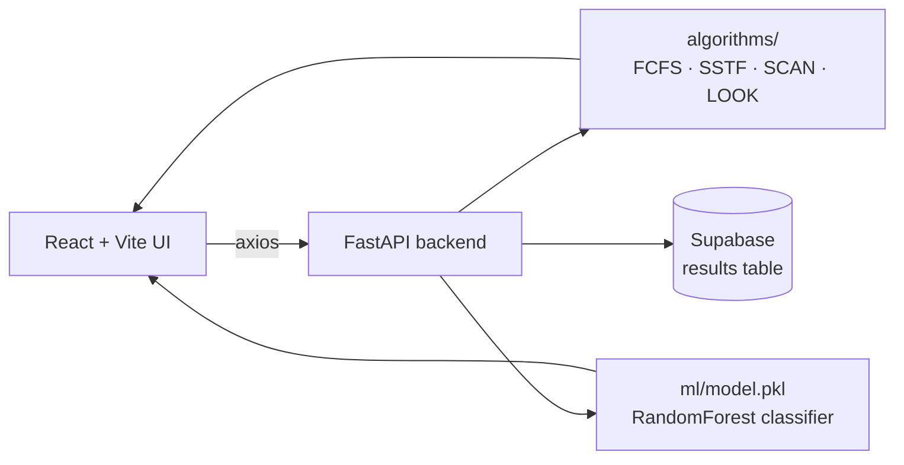

<div align="center">


</div>

## 📌 Overview

Picking the right disk-scheduling algorithm (FCFS, SSTF, SCAN, LOOK) for a given request queue is usually done by trial and error. This tool runs all four classical algorithms on the same request queue and head position, compares their seek times, and also runs a trained RandomForest classifier that predicts the best algorithm directly from queue statistics (count, spread, variance, sequentiality). Results can be saved to Supabase and reviewed later, and a React dashboard visualises the seek-time comparison.

## ✨ Features

- 🖥️ Runs FCFS, SSTF, SCAN and LOOK on one request queue in a single call (`/run-all`)
- 🤖 ML-based prediction of the best algorithm from a trained RandomForest model (`/predict`)
- 📊 9-feature extraction (count, mean, max/min, avg distance, left/right split, variance, sequentiality) feeding the model
- 💾 Optional Supabase persistence of each run (`/save`) and history lookup (`/history`)
- 📈 Recharts-based visual comparison of seek times on the frontend
- 🎞️ Animated UI built with Tailwind CSS and Framer Motion
- ❤️ Liveness probe endpoint (`/health`) for quick backend checks

## 🛠️ Tech Stack

| Layer | Technology |
|---|---|
| Frontend |     |
| Backend |  |
| ML |  pandas · joblib |
| Database |  |

## 🏗️ Architecture



## 📂 Project Structure

```
Intelligent-Disk-Scheduling-Optimizer/
├── backend/
│   ├── main.py             # FastAPI app: /run-all, /predict, /save, /history, /health
│   ├── algorithms/          # fcfs, sstf, scan, look implementations
│   ├── ml/
│   │   ├── generate_dataset.py
│   │   ├── train_model.py
│   │   ├── model.pkl
│   │   └── label_encoder.pkl
│   └── requirements.txt
├── frontend/
│   ├── src/
│   ├── package.json
│   └── vite.config.js
├── .env.example
└── LICENSE
```

## ⚙️ Installation

```bash
git clone https://github.com/Fayaz-2007/Intelligent-Disk-Scheduling-Optimizer.git
cd Intelligent-Disk-Scheduling-Optimizer

# Backend
cd backend
pip install -r requirements.txt

# (one-time) generate the training data and train the ML model
python ml/generate_dataset.py
python ml/train_model.py

uvicorn main:app --reload

# Frontend (second terminal)
cd frontend
npm install
npm run dev
```

### Environment variables

Create a `.env` file at the project root (Supabase is optional — `/save` and `/history` return 503 without it):

| Variable | Description |
|---|---|
| `SUPABASE_URL` | Your Supabase project URL |
| `SUPABASE_KEY` | Your Supabase project API key |

## 🚀 Usage

1. Start the backend and frontend as above.
2. Enter a disk request queue and the current head position in the UI.
3. Click run — the backend executes FCFS, SSTF, SCAN and LOOK and returns each seek-time result.
4. The ML classifier separately predicts which algorithm it expects to perform best for that queue.
5. Optionally save the run to Supabase and revisit it later from the history view.

`[Screenshot: request queue input + algorithm comparison chart]`

`[Screenshot: ML prediction panel]`

## 🔮 Future Improvements

- Add C-SCAN and C-LOOK algorithms for a fuller comparison
- Retrain the ML model on real-world disk-access traces, not just synthetic data
- Add a Node (`server.js`) proxy mode as an alternative to calling FastAPI directly
- Auth-gated history so each user only sees their own saved runs
- Export comparison charts as images/PDF

## 👨‍💻 Author

**Fayaz Ahmed**
GitHub: [@Fayaz-2007](https://github.com/Fayaz-2007)
LinkedIn: [fayaz-ahmed-59287631a](https://linkedin.com/in/fayaz-ahmed-59287631a)

<div align="center">


</div>
